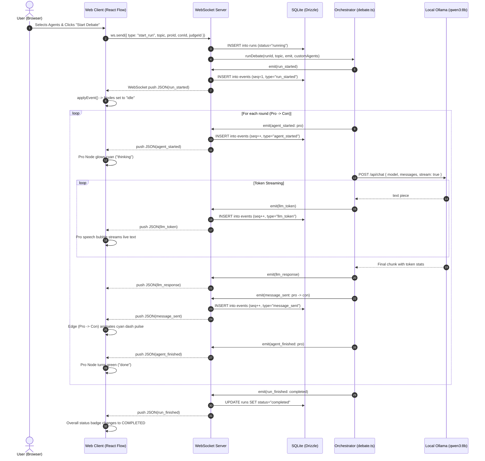

# Architecture Chapter

## 1. System Overview

The platform is designed around a decoupled, event-driven, local-first architecture. It bridges real-time Large Language Model (LLM) execution with an interactive visual canvas and persistent storage.

```
┌─────────────────────────────────────────────────────────────────────────────────┐
│                           CLIENT BROWSER (Vite + React)                         │
│                                                                                 │
│   ┌───────────────────────────┐         ┌───────────────────────────────────┐   │
│   │   React Flow Canvas       │         │   MessageLog Sidebar              │   │
│   │   • Nodes (AgentNode.tsx) │◄───────►│   • Chronological feed            │   │
│   │   • Edges (computedEdges) │  Hover  │   • Token counts & latency        │   │
│   └─────────────▲─────────────┘  Click  └─────────────────▲─────────────────┘   │
│                 │                                         │                     │
│                 └───────────────────┬─────────────────────┘                     │
│                                     │                                           │
│                       applyEvent(state, event) Reducer                          │
│                                     │                                           │
│                 ┌───────────────────┴─────────────────────┐                     │
│                 │      useRun() Hook & WebSocket Client    │                     │
│                 └───────────────────▲─────────────────────┘                     │
└─────────────────────────────────────┼───────────────────────────────────────────┘
                                      │ WebSocket (/ws) & HTTP (REST)
┌─────────────────────────────────────▼───────────────────────────────────────────┐
│                           BACKEND SERVER (Node.js / Express)                    │
│                                                                                 │
│   ┌────────────────────────────────┐       ┌────────────────────────────────┐   │
│   │   Express HTTP Endpoints       │       │   WebSocket Server (ws)        │   │
│   │   • /runs, /runs/:id/events    │       │   • Receives: start_run        │   │
│   │   • /agents (CRUD), /models    │       │   • Pushes: JSON(AgentEvent)   │   │
│   └─────────────┬──────────────────┘       └────────────────▲───────────────┘   │
│                 │                                           │                   │
│                 │                       emit(event) Callback│                   │
│                 │                                           │                   │
│                 │                  ┌────────────────────────┴───────────────┐   │
│                 │                  │   Multi-Agent Orchestrator (debate.ts) │   │
│                 │                  │   • Turn sequencing & prompt building  │   │
│                 │                  └────────────────────────┬───────────────┘   │
│                 │                                           │                   │
│                 │                                           │ chat() HTTP       │
│                 ▼                                           ▼                   │
│   ┌───────────────────────────────┐        ┌────────────────────────────────┐   │
│   │   SQLite Database (data.db)   │        │   Local Inference Engine       │   │
│   │   via Drizzle ORM             │        │   (Ollama - qwen3:8b)          │   │
│   │   • agents, runs, events      │        │   • POST /api/chat (streaming) │   │
│   └───────────────────────────────┘        └────────────────────────────────┘   │
└─────────────────────────────────────────────────────────────────────────────────┘
```

The system comprises four decoupled subsystems:
1. **Presentation Layer (`apps/web`)**: A single-page application built with React, Vite, and `@xyflow/react` (React Flow). It manages visual graph rendering, live text streaming, edge animation, and historical run replay.
2. **Communication & API Layer (`apps/server`)**: An Express server combined with a `ws` WebSocket server. It exposes REST endpoints for data retrieval and streams event envelopes live to connected browser clients over persistent sockets.
3. **Orchestration & Runtime Engine (`apps/server/src/orchestrator`)**: The core domain logic that manages agent roles, constructs dialogue history, and sequences conversation rounds. It delegates model calls to a lightweight HTTP client (`ollama.ts`) talking to local Ollama.
4. **Persistence Layer (`apps/server/src/db`)**: SQLite managed by Drizzle ORM (`better-sqlite3`). Every run record, agent definition, and emitted event is recorded locally in `data.db`.

---

## 2. The Event-Driven Model

The unifying foundation of the platform is the **Append-Only Event Stream**. Rather than transmitting arbitrary JSON payloads or updating UI state directly from model callbacks, every system action is reified as an immutable, typed `AgentEvent`.

### 2.1 The Event Contract
Defined in `packages/shared/src/events.ts`, `AgentEvent` is a discriminated union sharing universal metadata (`id`, `runId`, `timestamp`):

```typescript
export type AgentEvent =
  | { type: "run_started"; task: string; agentIds: string[] }
  | { type: "agent_started"; agentId: string }
  | { type: "llm_token"; agentId: string; text: string }
  | { type: "llm_response"; agentId: string; promptTokens: number; outputTokens: number; durationMs: number }
  | { type: "message_sent"; fromAgentId: string; toAgentId: string; content: string }
  | { type: "agent_finished"; agentId: string; result?: string }
  | { type: "run_finished"; status: "completed" | "failed" | "stopped" };
```

### 2.2 Event Lifecycle during a Debate Turn
A single turn between two agents (e.g., Pro speaking to Con) emits the following structured event sequence:

```
1. agent_started   ──► Sets Pro node status to 'thinking', clears previous text
2. llm_token       ──► Real-time text chunk appended to Pro's speech box (repeated)
3. llm_response    ──► Records prompt tokens, output tokens, and execution time (ms)
4. message_sent    ──► Finalizes turn text, pulses animated edge Pro ──► Con
5. agent_finished  ──► Marks Pro node status as 'done'
```

Because every observer (WebSocket client, SQLite database, logger) consumes this exact sequence, adding persistence or analytics requires **zero modifications to the agent reasoning code**.

---

## 3. Decoupled Orchestration Design

In monolithic frameworks like CrewAI or early AutoGen versions, execution logic is tightly coupled with terminal output or remote telemetry. In this platform, the orchestrator follows the **Inversion of Control (IoC)** pattern:

```typescript
export async function runDebate(
    runId: string,
    topic: string,
    emit: (event: AgentEvent) => void,
    customAgents?: { pro?: AgentConfig; con?: AgentConfig; judge?: AgentConfig }
): Promise<void>
```

### Key Architectural Strengths:
* **The orchestrator does not know transport exists**: It has no reference to WebSockets, HTTP requests, or browser DOM elements. It simply calls `emit(event)`.
* **Zero side-effects on business logic**: When we added SQLite persistence in Week 6, we did not modify `debate.ts`. The WebSocket handler simply tapped into `emit(event)` to insert the event into SQLite before sending it to the client:
  ```typescript
  await runDebate(runId, topic, (event) => {
      db.insert(events).values({ ... }).run();   // 1. Save to DB
      socket.send(JSON.stringify(event));        // 2. Broadcast to UI
  }, customAgents);
  ```

---

## 4. Client State Architecture: Pure Reducer Pattern

Managing state in real-time streaming interfaces often leads to race conditions, dropped packets, and visual inconsistencies. This platform solves this by implementing an **Event Sourcing / Pure Reducer Pattern** in `apps/web/src/runState.ts`:

$$\text{RunState} = \sum_{i=1}^{n} \text{applyEvent}(\text{State}_{i-1}, \text{Event}_i)$$

```typescript
export function applyEvent(state: RunState, event: AgentEvent): RunState {
  switch (event.type) {
    case "run_started":
      return { ...state, status: "running", agents: initializeAgents(event), messages: [] };
    case "agent_started":
      return updateAgent(state, event.agentId, { status: "thinking", liveText: "" });
    case "llm_token":
      return appendLiveText(state, event.agentId, event.text);
    case "message_sent":
      return appendMessageAndActiveEdge(state, event);
    case "agent_finished":
      return updateAgent(state, event.agentId, { status: "done" });
    case "run_finished":
      return { ...state, status: event.status };
    default:
      return state;
  }
}
```

### Why this makes Replay Free:
* In standard web apps, viewing historical runs requires custom screens, different data models, and mock states.
* In our architecture, the custom React hook `useRun.ts` exposes:
  ```typescript
  function loadEvents(pastEvents: AgentEvent[]) {
      setEvents(pastEvents);
  }
  ```
* When a user clicks **"View"** on a past run in `PastRuns.tsx`, the client fetches `GET /runs/:id/events` and passes the historical event array into `loadEvents`.
* The hook runs `events.reduce(applyEvent, initialState)` and produces the exact final graph layout, node statuses, token counters, and message log cards with **zero dedicated replay visualization code**.

---

## 5. Data Model (SQLite & Drizzle ORM)

All system data is stored in a single local file (`data.db`) managed via Drizzle ORM with `better-sqlite3`.

```
┌────────────────────────────┐       ┌────────────────────────────┐
│           runs             │       │           agents           │
├────────────────────────────┤       ├────────────────────────────┤
│ id: text (PK)              │       │ id: text (PK)              │
│ task: text                 │       │ name: text                 │
│ status: text               │       │ role: text (system prompt) │
│ startedAt: integer         │       │ model: text ("qwen3:8b")   │
│ finishedAt: integer        │       │ createdAt: integer         │
└─────────────┬──────────────┘       └────────────────────────────┘
              │ 1
              │
              │ N
┌─────────────▼──────────────┐
│          events            │
├────────────────────────────┤
│ id: text (PK)              │
│ runId: text (FK -> runs.id)│
│ seq: integer (1, 2, 3...)  │
│ type: text                 │
│ payload: text (JSON)       │
│ timestamp: integer         │
└────────────────────────────┘
```

### Justification for `payload: text (JSON)`:
Different events possess completely distinct schemas (e.g., `llm_token` contains `text`, whereas `llm_response` contains `promptTokens`, `outputTokens`, and `durationMs`).
Storing the complete typed event as serialized JSON in `payload` achieves two key architectural goals:
1. **Schema Agility**: Introducing new event types in future phases (e.g., tool invocations, human feedback interrupts) requires zero database migrations.
2. **Direct Rehydration**: Fetching `/runs/:id/events` simply parses `e.payload` back into native TypeScript objects and streams them straight into the client reducer.

---

## 6. End-to-End Sequence Diagram

The following sequence illustrates the execution flow from topic submission to persistent event broadcast:



---

## 7. Technology Choices and Justifications

Every technology in the platform was deliberately chosen to serve the thesis goal of **zero-cost, 100% local, type-safe multi-agent observation**:

| Technology | Role | Concrete Architectural Justification |
| :--- | :--- | :--- |
| **TypeScript Monorepo** | Full-Stack Language | Eliminates data contract desynchronization. The discriminated union `AgentEvent` in `packages/shared` is imported simultaneously by the backend orchestrator and the frontend React app. Any schema mismatch fails at compile-time (`npm run typecheck`). |
| **Node.js 24 + Express** | Backend Server | Native execution of TypeScript without heavy transpilation chains; Express provides minimal, rock-solid HTTP routing and static serving. |
| **`ws` (Native WebSockets)** | Event Streaming | Low-overhead bidirectional communication. Replaces inefficient HTTP polling with push latency of 1–4 ms on localhost. |
| **SQLite (`better-sqlite3`)** | Persistent Storage | Single-file database (`data.db`) requiring zero external background daemons, passwords, or configuration. Allows anyone cloning the repository to run the system immediately. |
| **Drizzle ORM** | Data Layer | Provides end-to-end type safety for queries while remaining dialect-agnostic. Enables future migration to PostgreSQL without rewriting application logic. |
| **`@xyflow/react` (React Flow)** | Graph Visualization | High-performance canvas library with virtualized viewport rendering, custom node components, flexible handle positioning, and built-in edge animation. |
| **Ollama + Qwen 3 8B** | Local Inference | Fast, capable open-weights LLM running completely offline on consumer hardware with zero token expenses or external privacy leaks. |

---

## 8. Summary

The architecture successfully decouples agent reasoning, state synchronization, visualization, and persistent storage. By anchoring the design in an append-only event stream and a pure client reducer, the system guarantees high-performance live monitoring alongside zero-cost post-hoc replay.
